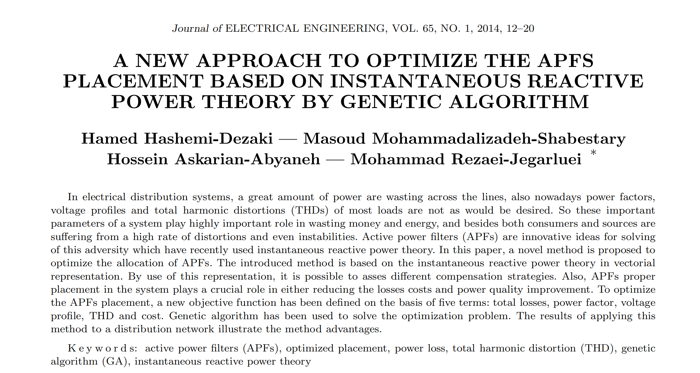

# Optimization of APFS Placement Based on Instantaneous Reactive Power Theory by Genetic Algorithm (Matlab Implementation)

Optimization of APFS Placement Based on Genetic Algorithm for Instantaneous Reactive Power Theory (Matlab Implementation)

## Images

<!-- PAYMENT_BLOCK -->

## Get this dataset

- Payment link (Stripe): [Buy now](https://buy.stripe.com/3cs8yP7sY87d0vu9AB)
- Payment QR code: 

<!-- /PAYMENT_BLOCK -->
